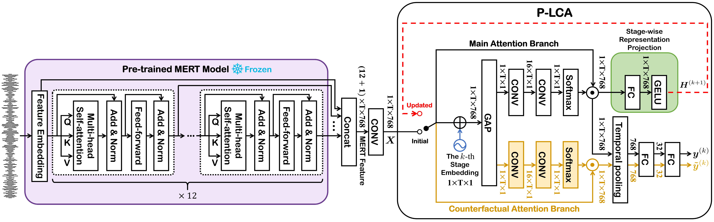
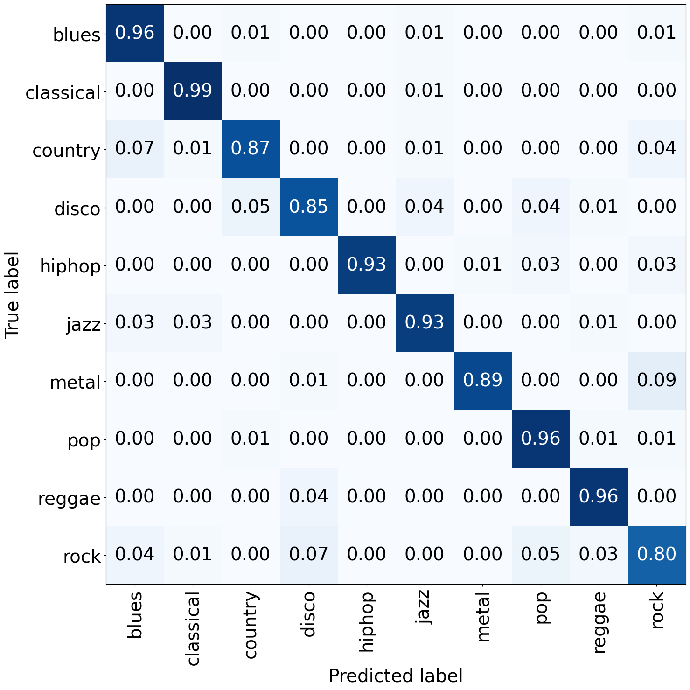

# Progressive Learnable Counterfactual Attention for Music Classification



<p align="center"> Proposed genreMERT (with P-LCA) architecture. </p>

## Introduction

This repo is official PyTorch implementation of **Progressive Learnable Counterfactual Attention for Music Classification (Interspeech 2026)**.

We introduce **Progressive Learnable Counterfactual Attention (P-LCA)**, a multi-stage refinement framework that extends LCA beyond a single representation space. By introducing stage-wise representation transformation, P-LCA enables later stages to re-examine bias-related patterns that may be difficult to separate earlier, leading to more focused attention and consistent performance improvements across multiple music classification tasks.

Pleaser refer to our **[paper](https://www.isca-archive.org/interspeech_2026/lin26_interspeech.html)** for further details.


## Getting started 

#### Installation & Clone the repo [Environment on Linux (Ubuntu 22.04 with python >= 3.8)]

```bash
# Clone the repo:
$ git clone ...
$ cd $PWD/Progressive-LCA

# Install the requirements using `conda` and `pip`: 
$ conda create -y -n genreMERT python=3.8
$ conda activate genreMERT
$ conda install -y pytorch=2.2.1 torchaudio=2.2.1 pytorch-cuda=11.8 -c pytorch -c nvidia
$ conda install -y lightning=2.2.0.post0 -c conda-forge

$ pip install -r requirements.txt

```

## Download weights 

Download the pre-trained genreMERT (w/ P-LCA) weights from [here](https://drive.google.com/file/d/1jcgjJesfQfwnQzXgzcfOyMNS_Cuy64_F/view?usp=sharing).

You need to unzip the contents, and the data directory structure should follow the hierarchy below.

```
${ROOT}  
|-- weights  
|   |-- genreMERT_P-LCA.ckpt
```

## Evaluation

Run the commands below under the folder src/ to evaluate a pretrained model on GTZAN test set.

You should be able to obtain the output below, which is identical to the result in Table 3 (see our paper):


```bash
$ cd src

# genreMERT (w/ P-LCA)
$ CUDA_VISIBLE_DEVICES=0 python main.py
Seed set to 0
Loading dataset...
Setting sample rate from 22050 to 24000
GPU available: True (cuda), used: True
TPU available: False, using: 0 TPU cores
IPU available: False, using: 0 IPUs
HPU available: False, using: 0 HPUs
Predicting test_dataset result
LOCAL_RANK: 0 - CUDA_VISIBLE_DEVICES: [0]
Predicting DataLoader 0: 100%|████████████████████████████████████| 6/6 [00:07<00:00,  4.30it/s]

Number of parameters: 94.99 (M)
Test accuracy of genreMERT P-LCA Layer 3:
Frame level: 0.91       Song level: 0.94
```

You should also be able to obtain the results under the ROOT/result.

### Results

| Models               | Frame Level Acc. | Song Level Acc. | #Para. (M) |
|----------------------|------------------|-----------------|------------|
| genreMERT (w/ LCA)   | 0.89             | 0.92            | 94.40      |
| genreMERT (w/ P-LCA) | 0.91             | 0.94            | 94.99      |

### Confusion matrix

| genreMERT (w/ LCA) | genreMERT (w/ P-LCA) Layer 3 |
|--------------------|--------------------|
|  |  |

## Citation

```bibtex
@inproceedings{lin26_interspeech,
  title     = {{Progressive Learnable Counterfactual Attention for Music Classification}},
  author    = {Yi-Xing Lin and Wen-Li Wei and Jia-Ching Wang and Jen-Chun Lin},
  year      = {2026},
  booktitle = {{Interspeech 2026}},
  pages     = {2630--2634},
  doi       = {10.21437/Interspeech.2026-147},
  issn      = {2958-1796},
}
```

## License
This project is licensed under the terms of the MIT license.

## References
This code is based on [koso019003/Adversarial-Rivalry-Learning](https://github.com/koso019003/Learnable-Counterfactual-Attention), [koso019003/Learnable-Counterfactual-Attention](https://github.com/koso019003/Learnable-Counterfactual-Attention) and partly based on [huggingface/transformers](https://github.com/huggingface/transformers).

The pre-trained weights of MERT used in genreMERT (w/ P-LCA) are from [here](https://huggingface.co/m-a-p/MERT-v1-95M).
